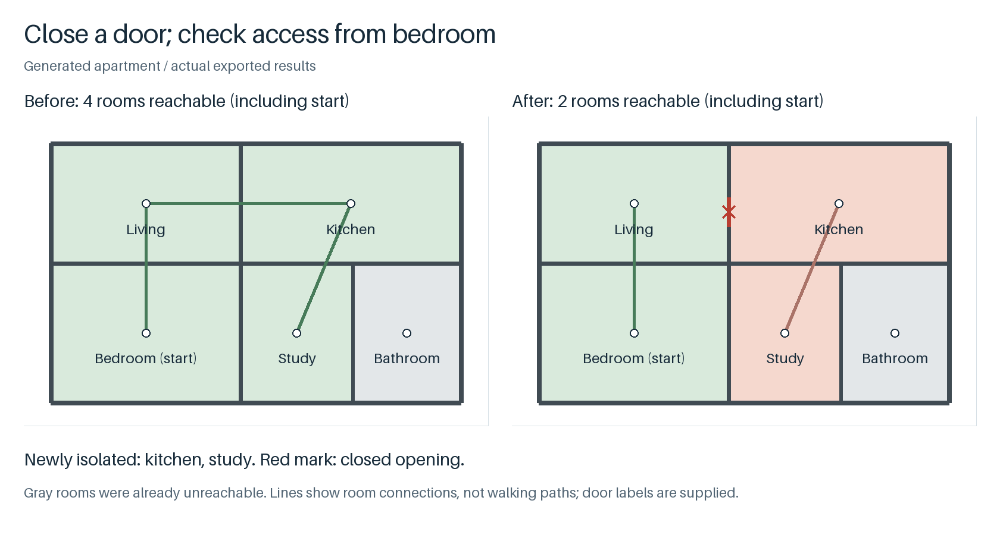

# PlanPortals

Connect rooms through doors, then check which rooms become unreachable when a door closes.

[中文](README.zh-CN.md) · [v0.2.0](https://github.com/crown-sports/planportals/releases/tag/v0.2.0)



Generated example: closing the living–kitchen door cuts access from the bedroom to **kitchen and study**; the gray bathroom was already unreachable. [Run this example](docs/workflow.md).

## Try it

Python 3.10+. No GPU, model or cloud service required.

```bash
python -m pip install "git+https://github.com/crown-sports/planportals.git@v0.2.0"
planportals demo --output runs/demo
planportals access --graph runs/demo/portals.json --from-room bedroom \
  --blocked-openings door-living-kitchen --output runs/access.json \
  --fail-on-newly-isolated
```

The demo supplies five rooms and typed openings. Open `runs/demo/portals.svg` to see the **3 accepted door connections**. The closure command writes `access.json`, then exits **1** because two rooms become newly isolated. It leaves the graph and geometry unchanged.

Use IDs from your graph's decisions. Unknown IDs or invalid inputs exit **2**. `route` also accepts `--blocked-openings` and `--fail-if-unreachable`.

## Bring your own rooms and openings

```bash
planportals build --input /private/scene.json --output runs/result
```

Supply room polygons, wall segments, and openings labeled as door, window or unknown. Adapters accept [WallGraph](https://github.com/crown-sports/wallgraph) wall paths and [PlanRegions](https://github.com/crown-sports/planregions) room exports. You can also import an aligned semantic label mask. [Scene format and API](docs/api.md).

A door needs wall support and consistent evidence for the rooms on both sides. Windows and unknown gaps stay out of the route graph. Rejected and ambiguous candidates keep their reasons in `portals.json`. [See the candidate-to-graph example](examples/demo.png).

## Read the result

`access.json` separates rooms that were already unreachable from rooms isolated by the supplied closures. Routes list room IDs and opening IDs; lines in the figure represent adjacency, not walking paths through furniture.

Door labels are supplied inputs, not predictions from an included detector. A wrong upstream label can still create a false connection. Geometric opening width is not verified door clearance, and a route report is not an accessibility or evacuation assessment. [Generated cases and failures](docs/validation.md).

## Use all four packages

The [shared walkthrough](docs/workflow.md) starts from one generated apartment and produces wall paths, room maps, calibrated areas, a missing-wall comparison and a door-closure report. Get the scripts from **current main**; the walkthrough installs the engines at their published tags.

## More

[Implementation notes](docs/product.md) · [API](docs/api.md) · [Methods](docs/methods.md) · [Architecture](docs/architecture.md)

[Contributing](CONTRIBUTING.md) · [Release checks](docs/releasing.md) · [Security](SECURITY.md)

MIT for code and original generated figures. No real drawings, annotations, datasets or model weights are included. [Provenance](NOTICE.md).
