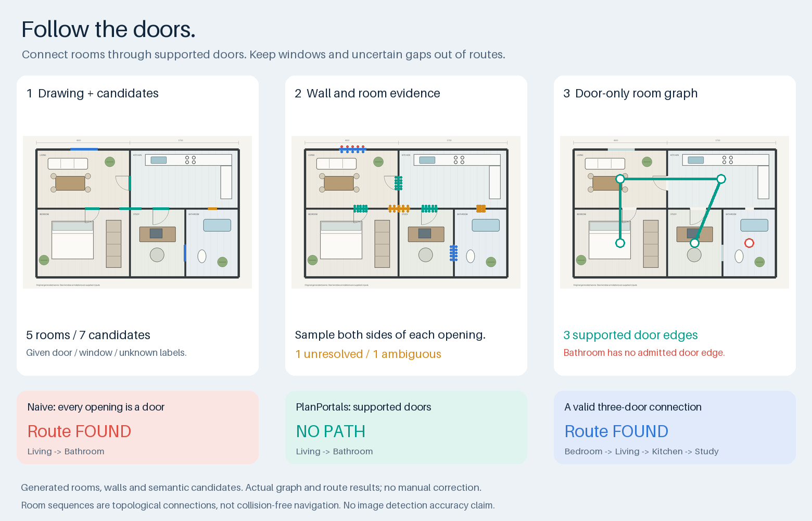

# PlanPortals

**沿着有依据的门连接房间，保留窗户和未知缺口的判断记录。**

[English](README.md) · [发布版本](https://github.com/crown-sports/planportals/releases)



这张生成的五房间图，程序实际建立了 **3 条门连接**：卧室 → 客厅 → 厨房 → 书房可以连通；浴室只有窗与未知缺口，仍然无路。房间几何和带类别的开口候选是已提供的输入，项目不包含训练好的门窗识别模型。

## 运行一下

Python 3.10 或更新版本，无需 GPU、模型或云服务。

```bash
python -m pip install "git+https://github.com/crown-sports/planportals.git@v0.1.0"
planportals demo --output runs/demo
```

查看 JSON 与 SVG 叠加图，每个开口保留采用、拒绝或不确定的依据。

```bash
planportals build --input /private/scene.json --output runs/result
```

可接自己的模型输出：原图尺寸的门窗语义标签图或开口线段；墙线来自 [WallGraph](https://github.com/crown-sports/wallgraph)，房间轮廓来自 [PlanRegions](https://github.com/crown-sports/planregions)。[输入格式、适配器与路线 API](docs/api.md)。

## 具体解决什么

| 输入证据 | 判断 |
| --- | --- |
| 门与墙段、两侧房间均明确 | 建立两房间之间的门连接 |
| 窗户 | 保留关联，不生成门连接 |
| 墙体预测中的未知缺口 | 保留未知，不猜成门 |
| 多条墙竞争，或两侧采样房间不一致 | 保留候选，并说明歧义 |
| 已有比例尺的门宽与宽度条件 | 检查给定阈值，报告是否满足 |

路线输出是**房间和开口 ID 的序列**，不是家具间的无碰撞行走轨迹，也不替代无障碍或疏散评估。开口线段宽度是几何观测，不等于已核实的门净宽。

## 技术与实测边界

语义连通域 → 墙体支撑 → 两侧房间证据 → 保守连接判断 → 图搜索。每一步结果都可追查。[方法](docs/methods.md) · [架构](docs/architecture.md)。

生成对比包含窗户、未知缺口、几何错位和错误的上游类别。正确处理已提供候选不代表完整图片识别准确；把窗误标成门，仍可能造成错误连接。[实验与实际结果](docs/validation.md)。

## 开发

```bash
python -m pip install -e '.[dev]'
pytest
python tools/render_demo.py --check
python tools/release.py --check
```

[贡献](CONTRIBUTING.md) · [安全报告](SECURITY.md) · [下载内容](docs/releasing.md)

代码使用 MIT，只附一张程序生成的复合效果图。真实图纸、标注、数据集和模型权重不随项目发布。[来源说明](NOTICE.md)。
